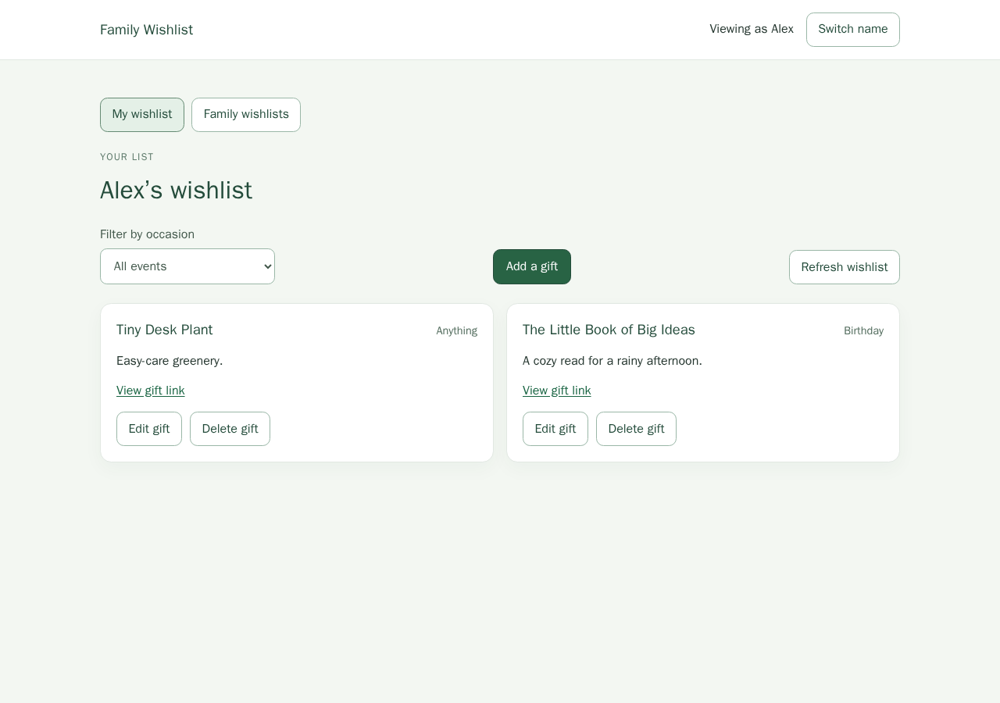
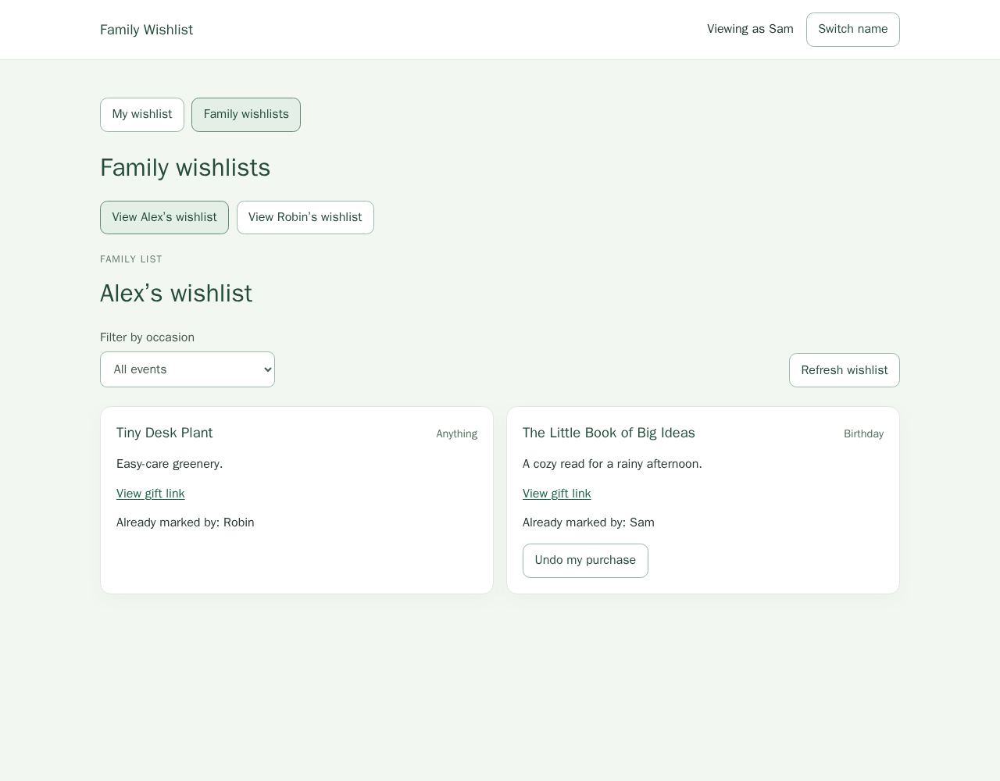
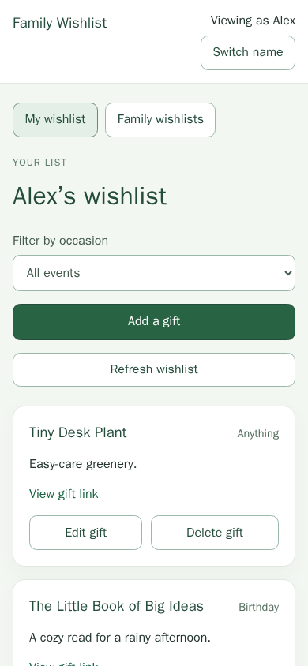

# Family Wishlist

A self-hosted wishlist for families to share gift ideas and coordinate purchases
without showing the recipient who bought what. Built with React and Django, with
SQLite storage and a prebuilt Docker image.

**For trusted family use only.** Choosing a name is not authentication. Anyone
with access can switch identities and reveal surprises. Do not expose this app
to the internet or untrusted users; accounts and TLS are not included.

## Features

- Choose a family member's name without creating an account.
- Add, edit and remove gifts with an optional link, price and notes.
- Organize gifts by configurable occasions or leave them as Anything.
- Coordinate purchases on other family members' lists; purchase details are
  omitted from the recipient's API responses and interface.
- Allow multiple different buyers for selected gifts, with each buyer able to
  undo only their own mark.
- Keep family names and occasions in YAML, with persistent gifts and sessions.
- Use the responsive interface on desktop and mobile.

## Screenshots

The screenshots show a source-development preview, not the older released `0.1.0`
image. They use fictional names and gift data; see the
[screenshot provenance](docs/images/README.md).

### Your wishlist

Manage gift ideas without purchase statuses or buyer information appearing on
your own list.



### Coordinating gifts

Other family members can see purchase marks and coordinate their own purchases.



### Mobile view



## Quick start

The released `0.1.0` image does not include the newer demo-data commands or UI
shown in the source-preview screenshots. The quick start below intentionally
continues to install that published release. To run the current source preview,
follow [development setup](docs/development.md#run-the-application) instead.

Install Docker Engine with Compose, or Docker Desktop in **Linux-container mode**.
Images support Linux `amd64` and `arm64`; ARM requires a 64-bit OS. Python, Node.js
and a source checkout are not required. Windows and macOS use Docker's Linux VM.

1. Open the [v0.1.0 release](https://github.com/klottick/present-wishlist/releases/tag/v0.1.0)
   and download its attached `compose.yaml`, `family.example.yaml` and
   `default.env.example` into a new directory. Use these assets, not the source
   archives. GitHub renames the uploaded `.env.example` to `default.env.example`.
2. Copy `family.example.yaml` to `family.yaml` and `default.env.example` to `.env`.
   Edit the family names and occasions in `family.yaml`.
3. Generate a private random secret with `openssl rand -hex 32` and set
   `DJANGO_SECRET_KEY` in `.env`. Keep this file private and retain the same secret
   across updates. On Linux/macOS, use `chmod 600 .env` and ensure `family.yaml`
   is readable by container UID 10001, for example `chmod 644 family.yaml` inside
   a private installation directory. The template already pins the image version.
4. From that directory, run:

   ```sh
   docker compose config --quiet
   docker compose pull
   docker compose up -d --wait
   ```

Open **http://localhost:8000**, choose your name, and start your wishlist. Check
`docker compose ps` for health or `docker compose logs --tail=100 app` for startup
errors. Port 8000 must be available. The default binding is loopback-only.

Keep `.env` out of version control. Avoid sharing `docker compose config` output
without `--quiet`, because the resolved configuration contains your secret.

## Family configuration

The installation's `family.yaml` defines the available people and occasions:

```yaml
members:
  alex: Alex
  sam: Sam
events:
  birthday: Birthday
  christmas: Christmas
```

Keys are permanent identities; labels are the displayed names. Rename a person
or occasion by changing its label, not its key. Anything is built in and must
not be added to the event mapping.

Restart the backend after YAML changes with `docker compose restart app`. If your
editor replaces the file, use `docker compose up -d --force-recreate --wait app`
to refresh its bind mount. See the [configuration guide](docs/configuration.md)
for validation rules, removing/reactivating entries and development paths.

## Using the wishlist

1. Choose your configured name. Use **My wishlist** to manage your gifts and
   **Family wishlists** to browse someone else's list.
2. Assign a gift to one occasion or leave it as **Anything**. An occasion filter
   includes Anything gifts; the Anything-only filter shows only unassigned gifts.
3. Mark someone else's gift purchased. Ordinary gifts allow one buyer; check
   **Can be purchased multiple times.** to allow one mark per different buyer.
   There is no quantity field. Buyers can undo only their own marks.
4. Use the refresh control to see changes from other people. Live push updates
   are not provided.

Tabs sharing one browser session share the selected name. Use separate browser
profiles for concurrent identities. Purchase privacy prevents accidental
disclosure in the recipient view; it does not prevent deliberate impersonation.
Avoid storing credentials or sensitive information in gift notes.

## Storage and updates

The container reads `family.yaml` read-only and stores gifts, purchases and
sessions in a persistent named volume. Use one application instance per volume.
Back up the database, family file and `.env` before upgrading; keep the Compose
project name stable so updates reuse the original volume.

**`docker compose down -v` deletes stored gifts, purchases and sessions.** Normal
stop/start and `docker compose down` preserve the named volume. There is no
automatic schema rollback.

Follow the [operations guide](docs/operations.md) for trusted LAN access,
environment settings, backup/restore, exact-version updates and troubleshooting.

## Development and documentation

- [Development and testing](docs/development.md): Python/Node setup, local servers
  and `bash scripts/verify.sh`, including safe demo-data commands.
- [Releases and publisher reuse](docs/releases.md): multi-platform GHCR publication,
  recovery and adapting the reusable workflow to another stack.
- [Documentation index](docs/README.md): all guides, design records and historical
  reviews.
- [Release verification](docs/verification/docker-release.md): published digests,
  anonymous installation checks and known verification limitations.
